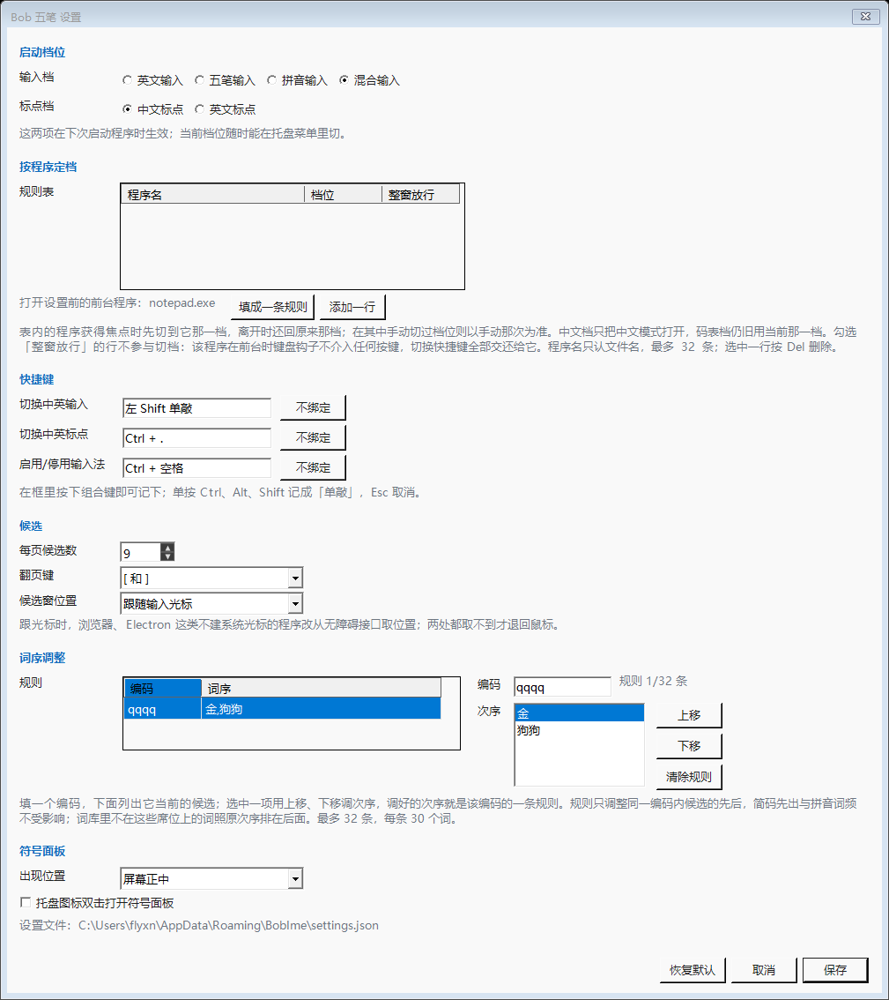

# Bob 五笔

**装上就不用管的 Windows 五笔：打字不联网、不占系统语言栏，进游戏自动英文、进聊天自动中文，五笔和拼音还能一起打。**

[](https://github.com/bobvan9/BobIme/actions/workflows/ci.yml)
[](https://github.com/bobvan9/BobIme/releases/latest)
[](LICENSE)


上面这张图正在打 `kan`：1–4 是五笔候选，5–9 是拼音候选，两套码表真的并列排在同一条候选栏里，不用切输入法。

这是一个自己用的 Windows 五笔输入法，图的是**简单**：打字不联网、不注册系统输入法、不拆字根、不做整句联想。
装上之后除了打字，你不用再碰它。
现在公开出来：源码、词库、构建脚本都在仓库里，安装包放在 Releases。

## 五个特点

| 特点 | 说明 |
| --- | --- |
| **打字不联网** | 没有云输入、不上报，打字过程中一个网络调用都没有。词库就是仓库里那两个文本文件（91462 条五笔 + 395529 条拼音），想改直接改文本。唯一的例外是「关于」窗口里版本号后面的「检查更新」：点一下才发一次 HTTPS 请求，只读最新一版的版本号，不下载、不自动装。「关于」里另一条「打开主页」只是叫浏览器打开项目页，本程序一个请求都不发。 |
| **不走系统语言栏** | 全局键盘钩子加置顶候选窗，不注册 TSF、不进输入法列表：语言栏不会多出条目，`Win+Space` 还是原来那几个，也不会跟微软拼音、搜狗抢 `Ctrl+Shift`。装完托盘多一个图标就算装好了，卸载也就删那几个文件。 |
| **按程序切输入状态** | 一张规则表，一行一个程序：游戏填「英文」、聊天软件填「混合」。窗口一获得焦点就切过去，走开自动还回原来那档。一进游戏就是英文、一进聊天就是中文，全程不用手动切、不用记快捷键。程序自行占用 `Ctrl+空格` 或单敲 Shift 时，勾选「整窗放行」，该窗口在前台时键盘钩子不介入任何按键。 |
| **五笔拼音混输** | 一次按键同时查两套词库，五笔候选在前、拼音候选在后，同一条候选栏里按数字键选。不是「五笔输入法带一个拼音辅助」，是两套码表并列排。 |
| **特殊符号随手点** | 托盘右键「符号输入」开出一块符号面板，11 组、三百多个符号，点一下直接进当前程序，面板不关能连着点。头一组「工程」就是机械制图那套：直径 `⌀`、度分秒 `°′″`、形位公差 `⊥ ∥ ≌ ○ ◎ ⊕`、沉孔锪孔 `⌴ ⌵`、单位 `㎜ ㎛ ℃`。 |

## 适合谁

- **不想折腾的人，包括上了年纪的老玩家**：装一次，开机自己起来（安装时勾上那项开机自启任务），之后状态看托盘图标颜色就行——蓝底「五」是中文，琥珀底「A」是英文。
- **主要在游戏和聊天软件之间来回切的人**：把程序名登记进规则表，输入档位跟着窗口走，不用记 `Ctrl+空格`、也不用记单敲 Shift。
- **不想让输入法进系统语言栏的人**：不占 `Win+Space` 列表，也不往系统里注册输入法，卸掉就干净了。
- **本来就打五笔的人**：混输档一次按键两套都查，五笔码照打，偶尔用拼音接一下。
- **常要打特殊符号的人，比如机械制图、写技术文档的**：制图符号、数学符号、带音调的拼音字母都在面板里，鼠标点就行，不用记内码、不用另开字符表。

## 不适合谁

- **提笔忘字的人。** 这里只有码表直查，不做字根拆分、不做容错编码：想不起五笔码，就得把整套拼音码拼对，
  而拼音按词频给候选、不做整句联想，长句要一个词一个词挑。指望"忘了码也能顺出来"，还是用成熟的拼音输入法。
- **要云词频、自动造句、表情和联网新词的人**：这些现在都没有。
- **只在全屏独占模式里玩游戏的人**：那种模式下任何外部窗口都画不上去，候选窗看不见；
  改成无边框窗口模式就正常（这是 Windows 的限制，见下面「已知限制」）。

## 安装

去 [Releases](https://github.com/bobvan9/BobIme/releases/latest) 下载 `BobIme-Setup-<版本>.exe`（约 40 MB，自带 .NET 运行时，不用另外装环境）。

1. 双击安装，会弹一次 UAC（全用户安装，默认装到 `C:\Program Files\BobIme`）。
2. **用之前把系统键盘布局改成「英语(美国)」**：设置 → 时间和语言 → 语言和区域，把「英语(美国)」放到首选语言最上面；
   或者控制面板 → 文字服务和输入语言（`Win+R` 输 `intl.cpl`）→「默认输入语言」选 英语(美国)。
   这个输入法不注册系统输入法，靠全局键盘钩子接管按键、用 Unicode 事件上屏，默认布局留给微软拼音就会两边同时组字。
3. 装完托盘出现蓝底「五」图标，开机自动启动。
4. 按 `Ctrl+空格` 打开，开始打字。

想直接跑源码：

```
git clone https://github.com/bobvan9/BobIme.git
cd BobIme
dotnet build
src/BobIme.Shell/bin/Debug/net10.0-windows/BobIme.Shell.exe
```

需要 Windows 10/11 x64 和 .NET 10 SDK。

## 怎么用

**1. 开。** `Ctrl+空格` 启用/停用。托盘图标就是状态：蓝底「五」是中文，琥珀底「A」是英文。

**2. 打。** 五笔码和拼音字母都直接敲，候选窗在光标旁边出来。候选先出单字、再出词组：
五笔还是简码先出，拼音还是按词频，只是词组一律排在所有单字后面，不会一上来就顶着一串词。

**3. 选。** 数字键 `1`–`9` 选当前页，空格取第一个，`[` `]` 翻页。

**4. 定档（可选，配一次就不管）。** 想让游戏窗口始终用英文：开着游戏窗口 → 托盘图标右键 → 设置 → 「按程序定档」→
点「填成一条规则」→ 档位选「英文」→ 保存。之后切进该窗口自动转英文，离开时还原；聊天软件同理，档位选「混合」。
若程序自行占用 `Ctrl+空格` 或单敲 Shift，勾选该行的「整窗放行」，该窗口在前台时键盘钩子不介入任何按键。

**5. 调序（可选，一次管一个码）。** 同一个码的词想换个先后：设置 → 「五笔词序」或「拼音词序」→ 填编码（五笔 `qqqq`、拼音 `gui`）→
选中一项按「上移」「下移」→ 保存。这个码敲满时，它名下的词整组提到最前、按你排好的次序出，所以拼音 `gui` 也能让「贵」排第一个。
两套各记各的：同一个编码在五笔和拼音里可以排成两种次序，改一边不动另一边。改完当场生效，不用重启，词库文件也不动。

**6. 升级（可选）。** 想知道有没有新版：托盘右键「关于」→ 点版本号后面的「检查更新」。它发一次请求读 GitHub 上最新一版的标签，
跟上面那行版本号比一下：有新版本就问一句要不要打开下载页，下载和安装还是你自己动手；没有就回一句「已经是最新版」。
这一下是整个程序唯一会联网的地方，点一下才有，平时一个请求都不发。

| 键 | 作用 |
| --- | --- |
| `Ctrl+空格` | 启用 / 停用输入法 |
| 单敲左 `Shift` | 中 / 英切换（按住 Shift 打大写字母不会误触） |
| `Ctrl+.` | 英文标点 / 中文标点 |
| `1`–`9` | 选当前页的候选 |
| `空格` `回车` | 上屏第一候选 |
| `[` `]` | 翻页（可换成 `- =`、`PgUp/PgDn`、`← →`） |
| `Backspace` | 删一位编码 |
| `Esc` | 清掉当前编码 |

这三个开关键都是默认值，设置里能各自改成别的组合键、改成单敲，或者不绑定。

几个具体例子：

- 打「中国」：五笔码是 `khlg`，拼音码是 `zhongguo`，混输档下两条路排第一的都是它。
- 打 `qqqq`：极点原表把「狗狗」排在「金」前面，想让「金」先出就照上面第 5 步调一次次序。
- 敲 `kan`：五笔段先出「看 看到 看着」，拼音段接在后面，一次按键两套都查得到。
- 打「CPU」不用切：大写字母一律不当编码，直接交给当前程序，前面没挑完的词先上屏，顺序是自然的。
- 打了一半 `qqw` 想起要切英文：按中英切换键时 `qqw` 原样上屏，切过去接着打就行；设置里取消勾选就改成直接丢掉。
- 打中文标点：中文标点档下 `, 。 、 ； 《》 ！ …… ×（）` 这些键都换成全角，`' "` 会一开一合交替。
- 要打 `⌀`、`′`、`≌`：托盘右键「符号输入」→「工程」组 → 点格子，符号就落在正在打字的窗口里，面板不关可以连着点好几个。

## 能设置什么



托盘图标右键就是全部功能：符号输入、标点档二选一、输入档四选一（英文 / 五笔 / 拼音 / 混合）、设置、说明、关于、退出。
版本号后面的「检查更新」和最后一行的「打开主页」都在「关于」窗口里，后者用浏览器打开本项目的 GitHub 主页。

设置界面里能改：

- **启动档位**：下次启动时的输入档和标点档。
  另有一条「切换为英文时，原中文编码直接上屏」（默认勾着）：打了一半的 `qqw` 按中英切换键时把 `qqw` 原样送进当前程序，取消勾选就是直接丢掉。这条保存后当场生效。
- **按程序定档**：一张规则表，三列：程序名、档位、整窗放行。程序名只认文件名，`wow`、`Wow.exe`、完整路径视为同一个。
  「填成一条规则」取打开设置之前位于前台的程序，想给某个程序定档就先开着它再进设置。
  勾选整窗放行后，该程序在前台时键盘钩子不介入任何按键。
- **快捷键**：中英切换、标点切换、启用停用，三个录入框，在框里按下组合键当场记下。
  快捷键被某个程序占用时，可以改绑，也可以在规则表里对该程序勾选整窗放行。
- **候选**：每页候选数 3–9、翻页键四组可选、候选窗位置三选一（跟随输入光标 / 跟随鼠标 / 桌面右下角）。
- **词序调整**：五笔和拼音各一块，填一个编码列出它当前的候选，上移、下移定次序，调好的次序记成该编码的一条规则，每块最多 32 条。
  编码敲满时它名下的词整组提到最前，这时会排到词频更高的其它码之前；没敲满时只在原本占的席位里换位。
  没登记规则的编码照词库原本的次序出：单字先出，简码先出、拼音按词频都不变。两套规则互不相干，同一个编码也能一边一个次序。
- **符号面板**：出现位置（屏幕正中 / 贴着光标），以及双击托盘图标是否直接打开面板。

配置文件在 `%APPDATA%\BobIme\settings.json`，手改也行；文件缺失或写坏了会整份回默认值，不会启动失败。
换电脑用设置界面最下面那一栏：「导出配置…」存成一个 json，到新机器上「导入配置…」选中它，再点保存。
导入只先把值铺到界面上，点「取消」什么也不改；选了不是本程序配置的文件会提示，不会静默换成默认值。

## 已知限制

- **系统键盘布局不是「英语(美国)」时先改过来**，否则编码会和系统输入法抢着组字（见上面「安装」第 2 步）。
- **以管理员权限运行的程序收不到按键**，这是 Windows UIPI 的限制，不是这里的 bug。
- **独占全屏程序里没有候选窗**（任何外部窗口都画不上去）。改成无边框窗口模式就正常。
- **记事本里打过一个标点后，接着上屏的中文可能显示成空心方框。** 字本身是好的，关掉记事本重开就恢复正常，
  是记事本自己的字体回退没重算；Word 和其他编辑器不受影响。

## 词库

| 文件 | 来源 | 条数 |
| --- | --- | --- |
| `data/dict/jidian86.tsv` | [极点 86 词库](https://github.com/KyleBing/rime-wubi86-jidian)（主表 + 扩展表合并，MIT） | 91462 |
| `data/dict/pinyin_base.tsv` | [rime-ice](https://github.com/iDvel/rime-ice) 的 `base` + `8105` + `41448` 三张表合并（GPL-3.0） | 395529 |

两份都在原表基础上做过清洗：挂在编码上的中文标点、带声调的拉丁字母、日语假名整块不加载，拼音还按词频和长度筛了一遍。
清洗规则和重新生成方式写在 [docs/internals.md](docs/internals.md)。

这两份表就是候选的全部来源。设置里的「五笔词序」「拼音词序」管的只是某个编码内谁先谁后、这一组排不排在最前，词库里没有的词它变不出来；
要往词库里加词，目前只能改这两份 TSV，改完重启程序（词库只在启动时读一次）。

## 许可

代码和自带的两份词库都以 **GPL-3.0-only** 发布，全文见 [LICENSE](LICENSE)。你拿走代码或词库再分发，
同样要按 GPL-3.0 公开对应源码，别的没有额外要求。

之所以整体走 GPL：`data/dict/pinyin_base.tsv` 派生自 [rime-ice](https://github.com/iDvel/rime-ice)
（GPL-3.0-only），派生数据按 GPL 分发就把整份产品带进同一义务，不如一份许可走到底，省得两套声明互相误读。
极点 86 那份是 MIT，MIT 兼容 GPL，合并分发不冲突。

「派生作品要给出对应源码」这条靠仓库里的转换脚本满足：`tools/conv_pinyin.pl` 和 `tools/conv_wubi.pl`
从上游原表重新生成这两份 TSV，用法写在 [docs/internals.md](docs/internals.md)。

## 更多

- [docs/internals.md](docs/internals.md)：实现笔记——每个功能的判定落在哪个类型、为什么这么定、踩过什么坑，以及怎么自己出安装包。
- [Releases](https://github.com/bobvan9/BobIme/releases)：安装包和版本历史。推 `v*` 标签会由 GitHub Actions 自动出包发布。
